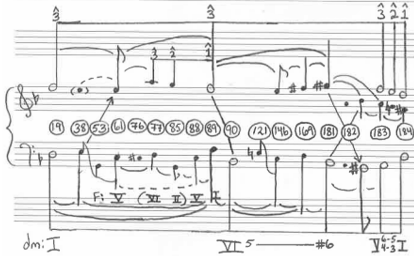

# ContrapunctusXI Middleground

[Back to the collection](../../README.md) · [MuNG XML](mung.xml) · [Workflow status](workflow.json) · [Open in MuNGStudio](https://mung-studio-schenker.com/#/simple-backend/ContrapunctusXI%20Middleground)

Snapshot: 2026-10-13T04:01:20.399361+00:00. **Current online annotation; see the stage statuses below.**

| Stage | Recorded status | Source |
| --- | --- | --- |
| recognition | done | explicit stage |
| assembly | not-started | explicit stage |
| temporal | not-started | explicit stage |

A missing stage record is shown as “not recorded”; the application may default it to `not-started`. Workflow completion is not a guarantee of musical or inferred semantic accuracy.

181 symbols · 35 noteheads · 108 syntax edges · 0 precedence edges · 1 recorded time groups.

## Files

- [mung.xml](mung.xml): exact source annotation XML, including original node IDs and metadata.
- [image.png](image.png): annotation canvas (832 × 516 pixels).
- [original.png](original.png): original image supplied with the page (832 × 516 pixels).
- [workflow.json](workflow.json): sanitized stage statuses and their provenance; generated for this export.

Image and XML bytes are preserved. Canvas pixels may reflect earlier preprocessing; the presence of an original scan does not imply this page was detected by a particular model. See the [manifest](../../manifest.json) for file hashes.

## Preview

## Observed symbol classes

| Class | Count |
| --- | ---: |
| `accidentalFlat` | 2 |
| `accidentalNatural` | 2 |
| `accidentalSharp` | 6 |
| `beamStructural` | 4 |
| `beamStructuralUnfoldingUp` | 2 |
| `braceAnalytical` | 1 |
| `characterHyphen` | 3 |
| `circleMeasureNumber` | 17 |
| `fClef` | 1 |
| `flagStructuralDown` | 2 |
| `flagStructuralUp` | 2 |
| `gClef` | 1 |
| `keyAnalysis` | 2 |
| `keySignature` | 2 |
| `legerLine` | 2 |
| `noteheadBlack` | 24 |
| `noteheadHalf` | 11 |
| `numeral1` | 2 |
| `numeral2` | 2 |
| `numeral3` | 5 |
| `numeral4` | 1 |
| `numeral5` | 2 |
| `numeral6` | 2 |
| `numeralRomanI` | 3 |
| `numeralRomanII` | 1 |
| `numeralRomanV` | 3 |
| `numeralRomanVI` | 2 |
| `parensImpliedLeft` | 2 |
| `parensImpliedRight` | 2 |
| `scaleDegreeMark` | 8 |
| `slurStructuralDown` | 16 |
| `slurStructuralDownDashed` | 1 |
| `slurStructuralUp` | 9 |
| `slurStructuralUpDashed` | 1 |
| `stemStructural` | 31 |
| `voiceExchangeDown` | 2 |
| `voiceExchangeUp` | 2 |
