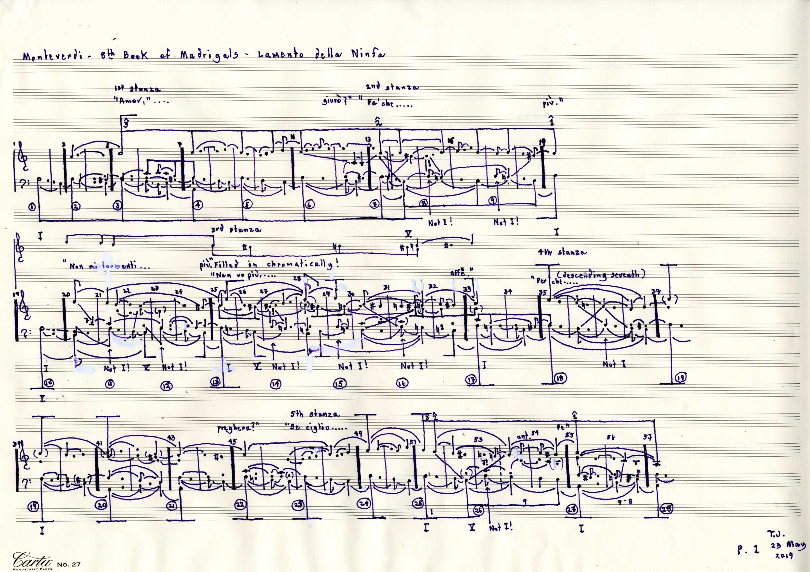

# Monteverdi Lamento della Ninfa - Page 001

[Back to the collection](../../README.md) · [MuNG XML](mung.xml) · [Workflow status](workflow.json) · [Open in MuNGStudio](https://mung-studio-schenker.com/#/simple-backend/Monteverdi%20Lamento%20della%20Ninfa%20-%20Page%20001)

Snapshot: 2026-10-13T04:01:20.399361+00:00. **Current online annotation; see the stage statuses below.**

| Stage | Recorded status | Source |
| --- | --- | --- |
| recognition | not-started | legacy page status |
| assembly | not recorded | not recorded |
| temporal | not recorded | not recorded |

A missing stage record is shown as “not recorded”; the application may default it to `not-started`. Workflow completion is not a guarantee of musical or inferred semantic accuracy.

1,072 symbols · 315 noteheads · 0 syntax edges · 0 precedence edges · 0 recorded time groups.

## Files

- [mung.xml](mung.xml): exact source annotation XML, including original node IDs and metadata.
- [image.jpg](image.jpg): annotation canvas (3303 × 2335 pixels).
- [original.jpg](original.jpg): original image supplied with the page (3303 × 2335 pixels).
- [workflow.json](workflow.json): sanitized stage statuses and their provenance; generated for this export.

Image and XML bytes are preserved. Canvas pixels may reflect earlier preprocessing; the presence of an original scan does not imply this page was detected by a particular model. See the [manifest](../../manifest.json) for file hashes.

## Preview

## Observed symbol classes

| Class | Count |
| --- | ---: |
| `accidentalNatural` | 19 |
| `accidentalSharp` | 21 |
| `barline` | 39 |
| `barlineHeavy` | 18 |
| `beamStructural` | 7 |
| `beamStructuralPartialLeft` | 3 |
| `beamStructuralPartialMiddle` | 12 |
| `beamStructuralPartialRight` | 2 |
| `characterExclamation` | 7 |
| `characterHyphen` | 1 |
| `circleMeasureNumber` | 24 |
| `fClef` | 3 |
| `flagStructuralDown` | 20 |
| `flagStructuralUp` | 23 |
| `gClef` | 4 |
| `keyAnalysisBm` | 1 |
| `legerLine` | 13 |
| `measureNumber` | 29 |
| `noteheadBlack` | 312 |
| `noteheadHalf` | 3 |
| `numeral1` | 1 |
| `numeral2` | 2 |
| `numeral3` | 1 |
| `numeralRomanI` | 15 |
| `numeralRomanV` | 4 |
| `otherText` | 19 |
| `parensImpliedLeft` | 4 |
| `parensImpliedRight` | 6 |
| `scaleDegreeMark` | 5 |
| `slurStructuralDown` | 124 |
| `slurStructuralUp` | 116 |
| `stemStructural` | 204 |
| `voiceExchangeDown` | 6 |
| `voiceExchangeUp` | 4 |
