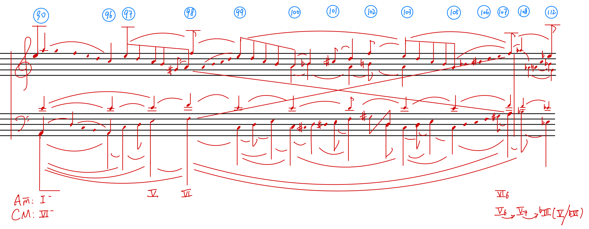

# Sean CmajFantasy 3.17

[Back to the collection](../../README.md) · [MuNG XML](mung.xml) · [Workflow status](workflow.json) · [Open in MuNGStudio](https://mung-studio-schenker.com/#/simple-backend/Sean%20CmajFantasy%203.17)

Snapshot: 2026-10-13T04:01:20.399361+00:00. **Current online annotation; see the stage statuses below.**

| Stage | Recorded status | Source |
| --- | --- | --- |
| recognition | done | explicit stage |
| assembly | not-started | explicit stage |
| temporal | not-started | explicit stage |

A missing stage record is shown as “not recorded”; the application may default it to `not-started`. Workflow completion is not a guarantee of musical or inferred semantic accuracy.

338 symbols · 90 noteheads · 0 syntax edges · 0 precedence edges · 0 recorded time groups.

## Files

- [mung.xml](mung.xml): exact source annotation XML, including original node IDs and metadata.
- [image.png](image.png): annotation canvas (2568 × 1000 pixels).
- [original.jpeg](original.jpeg): original image supplied with the page (2568 × 1000 pixels).
- [workflow.json](workflow.json): sanitized stage statuses and their provenance; generated for this export.

Image and XML bytes are preserved. Canvas pixels may reflect earlier preprocessing; the presence of an original scan does not imply this page was detected by a particular model. See the [manifest](../../manifest.json) for file hashes.

## Preview

## Observed symbol classes

| Class | Count |
| --- | ---: |
| `accidentalFlat` | 11 |
| `accidentalNatural` | 2 |
| `accidentalSharp` | 7 |
| `analyticalMinus` | 2 |
| `barline` | 2 |
| `beamStructural` | 3 |
| `beamStructuralPartialLeft` | 1 |
| `beamStructuralPartialMiddle` | 5 |
| `beamStructuralUnfoldingDown` | 1 |
| `circleMeasureNumber` | 14 |
| `fClef` | 1 |
| `flagStructuralDown` | 8 |
| `flagStructuralUp` | 7 |
| `gClef` | 1 |
| `keyAnalysis` | 2 |
| `legerLine` | 26 |
| `noteheadBlack` | 90 |
| `numeral6` | 2 |
| `numeral7` | 1 |
| `numeralRomanI` | 1 |
| `numeralRomanIII` | 1 |
| `numeralRomanV` | 4 |
| `numeralRomanVI` | 4 |
| `parensImpliedLeft` | 1 |
| `parensImpliedRight` | 1 |
| `secondaryHarmony` | 1 |
| `secondaryHarmonyArrowRight` | 2 |
| `slurStructuralDown` | 34 |
| `slurStructuralUp` | 27 |
| `stemStructural` | 74 |
| `voiceExchangeDown` | 1 |
| `voiceExchangeUp` | 1 |
