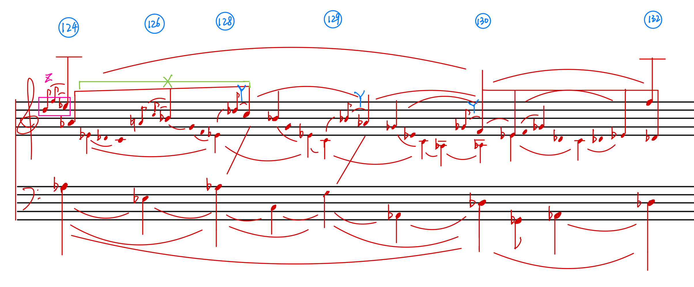

# Sean CmajFantasy 3.18c

[Back to the collection](../../README.md) · [MuNG XML](mung.xml) · [Workflow status](workflow.json) · [Open in MuNGStudio](https://mung-studio-schenker.com/#/simple-backend/Sean%20CmajFantasy%203.18c)

Snapshot: 2026-10-13T04:01:20.399361+00:00. **Current online annotation; see the stage statuses below.**

| Stage | Recorded status | Source |
| --- | --- | --- |
| recognition | done | explicit stage |
| assembly | pending-review | explicit stage |
| temporal | pending-review | explicit stage |

A missing stage record is shown as “not recorded”; the application may default it to `not-started`. Workflow completion is not a guarantee of musical or inferred semantic accuracy.

203 symbols · 47 noteheads · 0 syntax edges · 67 precedence edges · 34 recorded time groups.

## Files

- [mung.xml](mung.xml): exact source annotation XML, including original node IDs and metadata.
- [image.png](image.png): annotation canvas (2410 × 1000 pixels).
- [original.jpeg](original.jpeg): original image supplied with the page (2410 × 1000 pixels).
- [workflow.json](workflow.json): sanitized stage statuses and their provenance; generated for this export.

Image and XML bytes are preserved. Canvas pixels may reflect earlier preprocessing; the presence of an original scan does not imply this page was detected by a particular model. See the [manifest](../../manifest.json) for file hashes.

## Preview

## Observed symbol classes

| Class | Count |
| --- | ---: |
| `accidentalFlat` | 30 |
| `accidentalNatural` | 1 |
| `barline` | 1 |
| `beamStructural` | 2 |
| `beamStructuralPartialMiddle` | 2 |
| `characterCapitalX` | 1 |
| `characterCapitalY` | 3 |
| `characterSmallZ` | 1 |
| `circleMeasureNumber` | 6 |
| `fClef` | 1 |
| `flagStructuralDown` | 1 |
| `flagStructuralUp` | 7 |
| `gClef` | 1 |
| `legerLine` | 8 |
| `measureNumber` | 6 |
| `motiveBox` | 1 |
| `motiveBracket` | 1 |
| `noteheadBlack` | 47 |
| `slurStructuralDown` | 25 |
| `slurStructuralUp` | 17 |
| `stemStructural` | 39 |
| `voiceExchangeDown` | 2 |
