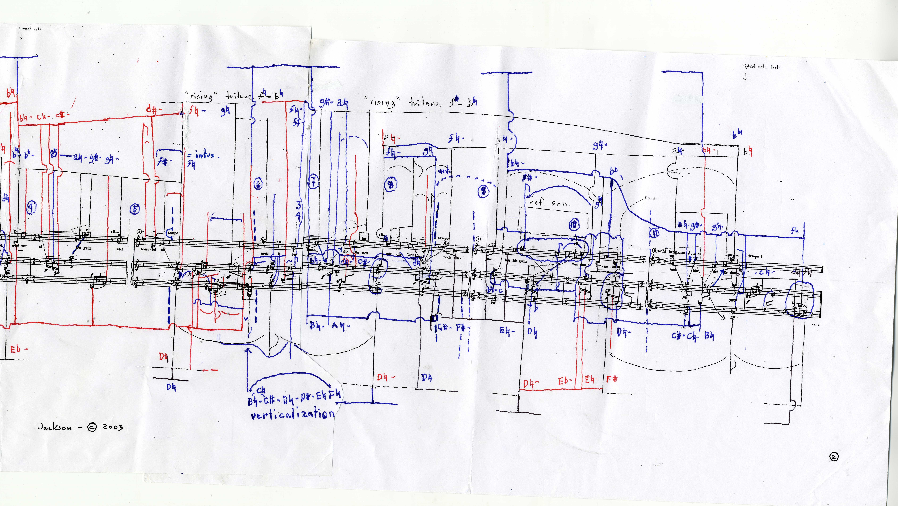

# Webern Wie bin ich froh Op. 25 No. 1 - Graph 010

[Back to the collection](../../README.md) · [MuNG XML](mung.xml) · [Workflow status](workflow.json) · [Open in MuNGStudio](https://mung-studio-schenker.com/#/simple-backend/Webern%20Wie%20bin%20ich%20froh%20Op.%2025%20No.%201%20-%20Graph%20010)

Snapshot: 2026-10-13T04:01:20.399361+00:00. **Current online annotation; see the stage statuses below.**

| Stage | Recorded status | Source |
| --- | --- | --- |
| recognition | not-started | legacy page status |
| assembly | not recorded | not recorded |
| temporal | not recorded | not recorded |

A missing stage record is shown as “not recorded”; the application may default it to `not-started`. Workflow completion is not a guarantee of musical or inferred semantic accuracy.

832 symbols · 147 noteheads · 0 syntax edges · 0 precedence edges · 0 recorded time groups.

## Files

- [mung.xml](mung.xml): exact source annotation XML, including original node IDs and metadata.
- [image.jpg](image.jpg): annotation canvas (6757 × 3815 pixels).
- [original.jpg](original.jpg): original image supplied with the page (6757 × 3815 pixels).
- [workflow.json](workflow.json): sanitized stage statuses and their provenance; generated for this export.

Image and XML bytes are preserved. Canvas pixels may reflect earlier preprocessing; the presence of an original scan does not imply this page was detected by a particular model. See the [manifest](../../manifest.json) for file hashes.

## Preview

## Observed symbol classes

| Class | Count |
| --- | ---: |
| `accidentalDoubleSharp` | 1 |
| `accidentalFlat` | 27 |
| `accidentalNatural` | 105 |
| `accidentalParensLeft` | 1 |
| `accidentalSharp` | 57 |
| `barline` | 15 |
| `barlineHeavy` | 1 |
| `beamStructural` | 51 |
| `beamStructuralPartialLeft` | 9 |
| `beamStructuralPartialMiddle` | 8 |
| `beamStructuralPartialRight` | 4 |
| `characterCapitalB` | 3 |
| `characterCapitalC` | 1 |
| `characterCapitalD` | 7 |
| `characterCapitalE` | 4 |
| `characterCapitalX` | 1 |
| `characterEqual` | 2 |
| `characterHyphen` | 41 |
| `characterSmallF` | 2 |
| `characterSmallG` | 3 |
| `circleMeasureNumber` | 5 |
| `flagStructuralDown` | 4 |
| `flagStructuralUp` | 7 |
| `gClef` | 4 |
| `keyAnalysisBm` | 1 |
| `keySignature` | 1 |
| `legerLine` | 37 |
| `measureNumber` | 2 |
| `motiveBracket` | 3 |
| `noteheadBlack` | 144 |
| `noteheadHalf` | 3 |
| `numeral1` | 1 |
| `numeral2` | 4 |
| `numeral3` | 5 |
| `numeral4` | 3 |
| `otherText` | 5 |
| `parensImpliedRight` | 11 |
| `scaleDegreeMark` | 3 |
| `slurStructuralDown` | 16 |
| `slurStructuralUp` | 28 |
| `staffLine` | 9 |
| `stemStructural` | 179 |
| `voiceExchangeDown` | 5 |
| `voiceExchangeUp` | 9 |
